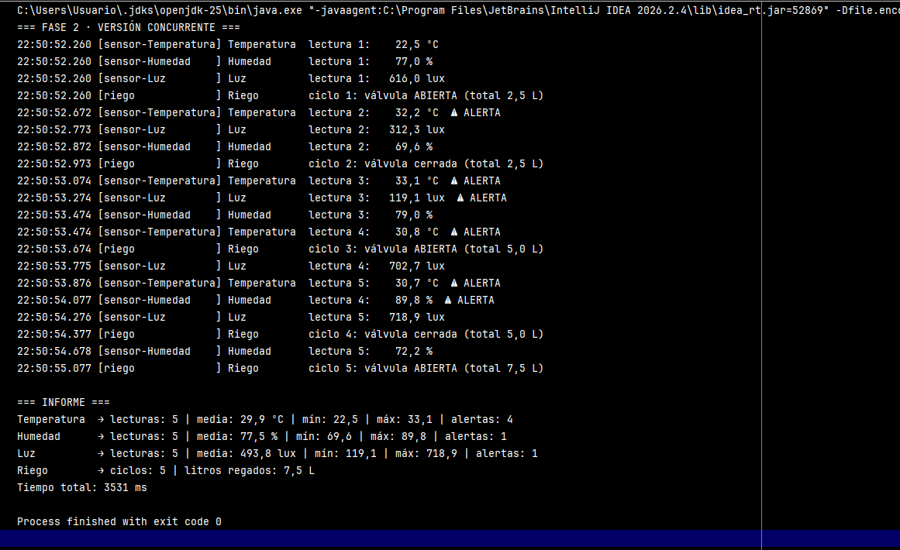

# Invernadero con hilos

Práctica 4 · Programación de Servicios y Procesos · 2.º DAM · Davante MEDAC Sevilla Este


## Qué hace

Simula un invernadero con tres sensores y un programador de riego:

| Dispositivo | Cada | Lecturas/ciclos | Rango correcto | Implementación |
|---|---|---|---|---|
| Temperatura | 400 ms | 5 | 18 – 30 ºC | `Runnable` |
| Humedad | 600 ms | 5 | 50 – 80 % | `Runnable` |
| Luz | 500 ms | 5 | 200 – 900 lux | `Runnable` |
| Riego | 700 ms | 5 ciclos (2,5 L por apertura) | — | `extends Thread` |

Cada sensor genera valores aleatorios, avisa con `⚠ ALERTA` si salen del rango y guarda sus propias estadísticas (lecturas, media, mínimo, máximo, alertas). Al final se imprime un informe.

El proyecto se ejecuta de cuatro formas:

- **Fase 1** · todo secuencial en el hilo `main`.
- **Fase 2** · un hilo por dispositivo, con `join()` antes del informe.
- **Fase 3** · tres experimentos: informe sin `join()`, `run()` en vez de `start()` y doble `start()`.
- **Fase 4** · un hilo vigilante demonio que muestra el estado de los cuatro hilos cada 300 ms.

### Estructura

```
src/invernadero/
├── Sensor.java              (abstracta, implements Runnable)
├── Temperatura.java
├── Humedad.java
├── Luz.java
├── ProgramadorRiego.java    (extends Thread, nombre de hilo "riego")
├── Fase1_Secuencial.java
├── Fase2_Concurrente.java
├── Fase3_Experimentos.java
└── Fase4_Vigilante.java
```

## Cómo ejecutarlo

**IntelliJ IDEA:** abrir el proyecto con JDK 21, marcar `src` como *Sources Root* y ejecutar el `main` de cualquiera de las clases `Fase…`.

**Terminal:**

```bash
javac -d out src/invernadero/*.java
java -cp out invernadero.Fase2_Concurrente
```

## Captura



Ejemplo de salida de la Fase 2:

```
18:59:16.181 [sensor-Humedad    ] Humedad      lectura 1:    81.5 %  ⚠ ALERTA
18:59:16.183 [sensor-Luz        ] Luz          lectura 1:   613.7 lux
18:59:16.183 [riego             ] Riego        ciclo 1: válvula ABIERTA (total 2.5 L)
18:59:16.184 [sensor-Temperatura] Temperatura  lectura 1:    25.7 ºC
18:59:16.599 [sensor-Temperatura] Temperatura  lectura 2:    19.2 ºC
...
18:59:19.003 [riego             ] Riego        ciclo 5: válvula ABIERTA (total 7.5 L)

=== INFORME ===
Temperatura  → lecturas: 5 | media: 22.5 ºC | mín: 16.6 | máx: 26.1 | alertas: 1
Humedad      → lecturas: 5 | media: 75.5 % | mín: 49.1 | máx: 87.8 | alertas: 4
Luz          → lecturas: 5 | media: 538.2 lux | mín: 95.5 | máx: 691.3 | alertas: 1
Riego        → ciclos: 5 | litros regados: 7.5 L
Tiempo total: 3549 ms
```

## Resultados

Tiempo que tarda cada dispositivo (5 repeticiones × su periodo):

| Dispositivo | Cálculo | Tiempo |
|---|---|---|
| Temperatura | 5 × 400 ms | 2000 ms |
| Humedad | 5 × 600 ms | 3000 ms |
| Luz | 5 × 500 ms | 2500 ms |
| Riego | 5 × 700 ms | **3500 ms** (el más lento) |

Tiempos medidos:

| Versión | Predicción | Ejecución 1 | Ejecución 2 | Ejecución 3 | Ejecución 4 |
|---|---|---|---|---|---|
| Fase 1 · Secuencial | suma = 2000 + 3000 + 2500 + 3500 = **11000 ms** | 11094 ms | — | — | — |
| Fase 2 · Concurrente | máximo = **3500 ms** (riego) | 3549 ms | 3569 ms | 3557 ms | 3562 ms |

La versión concurrente es unas **3,1 veces más rápida** (11094 / 3549).

## Análisis

### ¿Por qué compensa usar hilos en el invernadero?

La hipótesis se cumple con mis números. En la versión secuencial el tiempo total es la **suma** de los cuatro dispositivos (≈ 11 s), porque `main` no empieza la humedad hasta que termina la temperatura, y así con todos. En la versión concurrente los cuatro trabajan a la vez y el tiempo total es el del **más lento**, el riego con 3,5 s. Los ≈ 50–100 ms de diferencia con la predicción se deben a la creación de los hilos y a que `sleep()` nunca es exacto.

Pero lo importante en un invernadero no es solo la velocidad: en la versión secuencial, mientras se leía la humedad **nadie vigilaba la temperatura** durante 9 segundos. Con hilos cada sensor mantiene su propio ritmo (temperatura cada 400 ms, humedad cada 600 ms…) y una alerta se detecta en cuanto ocurre.

Compensa porque las tareas son **independientes** y pasan casi todo el tiempo **esperando** (`sleep`), no calculando. Si fueran tareas muy cortas o que dependieran unas de otras, el coste de crear hilos y sincronizarlos no merecería la pena.

También se ve que **el orden del log cambia entre ejecuciones**: en la primera línea de la Fase 2 a veces sale antes la humedad, a veces la luz o el riego. Lo decide el planificador del sistema operativo, no el orden en el que llamo a `start()`.

### Experimentos A, B y C

**A · Informe sin `join()`**

```
Sin esperar   → Temperatura  → sin lecturas todavía
...
Tras join()   → Temperatura  → lecturas: 5 | media: 22.2 ºC | ... | alertas: 3
```

La primera vez el informe sale vacío. `start()` solo pide arrancar el hilo y devuelve el control a `main` inmediatamente; `main` imprime el informe antes de que el sensor haya hecho ni una lectura. Es lo mismo que en el Ejemplo 0A, donde «main: … he terminado» salía antes que la cuenta atrás. Tras `join()`, `main` se queda esperando a que el hilo termine y el informe ya tiene las 5 lecturas.

**B · `riego.run()` en vez de `riego.start()`**

```
[main              ] Riego        ciclo 1: válvula ABIERTA (total 2.5 L)
...
Tiempo: 2104 ms
Estado de riego: NEW
```

- **Nombre del hilo en el log:** `main`, no `riego`. Llamar a `run()` es una llamada a un método normal: lo ejecuta el hilo que lo llama. No se crea ningún hilo nuevo.
- **Tiempo:** 2104 ms ≈ 3 × 700 ms. `main` se queda bloqueado esos 2 segundos, como en la Fase 1.
- **Estado:** `NEW`. El objeto `Thread` existe pero nunca se ha arrancado con `start()`, así que para la JVM sigue siendo un hilo sin iniciar.

Por eso en `ProgramadorRiego` uso `Thread.currentThread().getName()` en vez de `getName()`: si usara `getName()` el log diría `riego` aunque quien lo ejecuta de verdad es `main`, y el experimento escondería lo que está pasando.

**C · Doble `start()`**

```
Estado tras el primer start() y join(): TERMINATED
Excepción capturada: java.lang.IllegalThreadStateException
```

Un hilo solo se puede arrancar **una vez**. Tras terminar queda en `TERMINATED` y no puede volver a `NEW`. Llamar otra vez a `start()` lanza `IllegalThreadStateException` (estado del hilo no válido para esa operación). Si quisiera regar otra vez tendría que crear un objeto `ProgramadorRiego` nuevo.

### Estados observados

Fase 4, con el vigilante mostrando estados cada 300 ms:

| Estado | Cuándo aparece | Qué línea lo provoca |
|---|---|---|
| `NEW` | Antes de arrancar (y en el experimento B) | `new Thread(sensor, "...")` / `new ProgramadorRiego()` sin `start()` |
| `RUNNABLE` | Justo tras arrancar, mientras el hilo mide o imprime | `hilo.start()`; también al despertar de `sleep()` |
| `TIMED_WAITING` | Casi siempre: es lo que más se ve en la salida | `Thread.sleep(periodoMs)` en `run()` |
| `TERMINATED` | Cuando un hilo acaba sus 5 lecturas/ciclos. Primero la temperatura (2 s), luego luz, humedad y por último el riego | Fin del método `run()` |

`RUNNABLE` se ve poco porque medir e imprimir dura microsegundos, y el resto del tiempo el hilo está durmiendo.

**Estados que no aparecen:**

- `WAITING`: no aparece en los cuatro hilos del invernadero porque ninguno llama a `join()` sin tiempo ni a `wait()`. Sí lo tiene `main`, que está en `WAITING` mientras hace `join()`, pero el vigilante no lo vigila.
- `BLOCKED`: tampoco aparece porque no hay `synchronized`; ningún hilo compite por un cerrojo. Se verá en la UD6.

**¿Por qué termina el programa si el vigilante sigue en su bucle?**

Porque el vigilante es un hilo **demonio** (`vigilante.setDaemon(true)`, llamado **antes** de `start()`; después lanzaría `IllegalThreadStateException`). La JVM termina cuando ya no queda ningún hilo **no demonio** vivo. Cuando acaban los sensores, el riego y `main`, solo queda el vigilante, y la JVM lo corta aunque esté en su `while (true)`. Sin `setDaemon(true)` el programa no terminaría nunca y habría que pararlo a mano.

### Thread frente a Runnable

| Aspecto | `extends Thread` (riego) | `implements Runnable` (sensores) |
|---|---|---|
| Qué representa el objeto | **Es** un hilo | **Es** una tarea; necesita un `Thread` que la ejecute |
| Cómo se arranca | `riego.start()` | `new Thread(sensor, "nombre").start()` |
| Cómo se le da nombre | En el constructor: `super("riego")` | Segundo parámetro del constructor de `Thread` |
| Cómo obtiene el nombre del hilo | `getName()` (lo hereda) | `Thread.currentThread().getName()` (no tiene `getName()`) |
| Herencia | Consume la única herencia de Java | Deja libre la herencia para otra clase |
| Reutilización | Un objeto = un solo `start()` en su vida | La misma tarea se puede pasar a otro `Thread` nuevo, o ejecutar con `run()` en el hilo actual |
| Separación de responsabilidades | Mezcla «qué se hace» con «cómo se ejecuta» | Separa la tarea del mecanismo que la ejecuta |

**¿Por qué los sensores SOLO pueden ser Runnable en mi diseño?**

Porque `Temperatura`, `Humedad` y `Luz` **ya heredan de `Sensor`**, que es donde están los atributos, las estadísticas y el `run()` común. Java solo permite heredar de una clase, así que no pueden heredar también de `Thread`. La única forma de que se ejecuten en un hilo es que `Sensor` implemente `Runnable` y pasárselos a un `Thread`. (La alternativa sería que `Sensor extends Thread`, pero entonces mezclaría el modelo del sensor con el mecanismo de ejecución y cada sensor solo podría arrancarse una vez.)

**¿Qué forma elegiría para el riego y por qué?**

`Runnable`. `extends Thread` funciona aquí porque `ProgramadorRiego` no necesita heredar de nada más, pero me ata: si el día de mañana hubiera una clase base `Actuador` (riego, ventilación, calefacción…), no podría heredar de ella. Además, con `Runnable` podría volver a regar pasando la misma tarea a un `Thread` nuevo, en vez de chocar con la `IllegalThreadStateException` del experimento C. `extends Thread` lo dejaría solo para casos sencillos como el Cohete del Ejemplo 0A.
